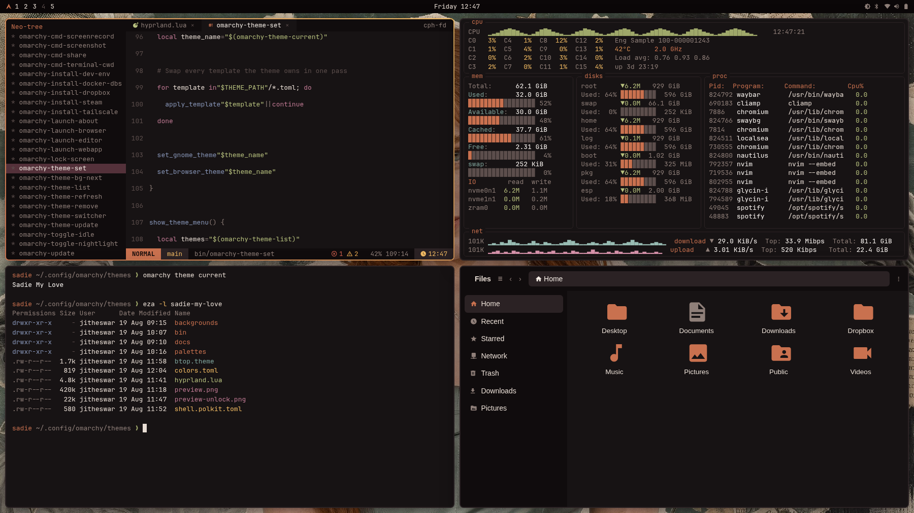

# Sadie My Love

A copper and oxblood theme for [Omarchy](https://omarchy.org). Change the wallpaper and the colors shift with it, without the theme turning into something else.



It ships four wallpapers. Each one gets its own slightly rotated version of the same palette, so switching backgrounds re-tints the bar, borders, terminal, btop and editor together.

## Install

Requires Omarchy 4.5 or newer.

The theme runs a little code of its own: a Hyprland config for its borders,
glass and motion, and a watcher that follows the wallpaper. Omarchy only runs
that for themes you keep yourself, so clone it somewhere and link it in:

```
git clone https://github.com/Jitheswar/sadie-my-love ~/.local/share/sadie-my-love
ln -s ~/.local/share/sadie-my-love ~/.config/omarchy/themes/sadie-my-love
omarchy theme set sadie-my-love
```

`omarchy theme install https://github.com/Jitheswar/sadie-my-love` also works,
but Omarchy strips the Lua from themes installed that way. You still get the
palette, the copper-to-amber borders and the dressed shell, fixed on the first
wallpaper's colors, without the watcher, blur tuning, ember shadow or motion.

Change wallpaper with `omarchy theme bg next` (`SUPER + CTRL + SHIFT + SPACE` by default). The colors follow within a second.

To update, throw away the live palette the watcher wrote and pull:

```
git -C ~/.local/share/sadie-my-love checkout -- .
git -C ~/.local/share/sadie-my-love pull
```

## How the colors work

There is one hand-tuned palette, stored as `REFERENCE` in `bin/generate-palettes`. It keeps even steps of lightness across the backgrounds, soft body text, at least 4.5:1 contrast on all text, and terminal colors that stay easy to tell apart.

Each wallpaper only rotates the hue of that palette, based on its own dominant color. Lightness and chroma are never changed, so the contrast holds on every wallpaper. Rotation happens in Oklch, because a plain HSL rotation pushes yellows around far more than reds.

Three limits keep the result recognizable:

| | |
|---|---|
| **Strength** | Only 70% of the wallpaper's measured hue offset is applied. |
| **Clamp** | Rotation never goes past 28 degrees. |
| **Damping** | Near-gray colors rotate less, so plain text and surfaces don't pick up a tint. |

The four wallpapers end up at +0.0, -19.2, -9.2 and +2.2 degrees.

Pulling colors straight from each wallpaper didn't work. On `01-1412030`, six of the sixteen slots came out within a few RGB units of each other, so a passing color and a failing one looked the same. That's why there's a hand-tuned reference plus a rotation.

## Nothing is hardcoded

No file in the theme has a color written into it. Everything is generated from `colors.toml` when the palette is applied. If `btop.theme` were written by hand, it would stay on the reference copper while the bar and borders rotated 19 degrees away on wallpaper 02.

- `btop.theme` and `shell.*.toml` are rendered by `bin/generate-btop` and `bin/generate-shell` (the shell designs live in `templates/`), because Omarchy copies both verbatim.
- `hyprland.lua` reads the live `colors.toml` each time Hyprland loads it.
- Each palette also carries `hyprland_active_border` and `hyprland_inactive_border`, which Omarchy uses for window borders and the shell's border tokens.

The reasoning is in `docs/adr/0001-every-themed-artefact-is-derived.md`.

## What's in the repo

```
backgrounds/           the four wallpapers
palettes/              one colors.toml per wallpaper (generated)
colors.toml            the live palette, a copy of one of the above
templates/             shell section designs, as {{ palette key }} templates
bin/generate-palettes  rebuild palettes/ from the reference palette
bin/generate-btop      rebuild btop.theme from the live palette
bin/generate-shell     rebuild shell.*.toml from the live palette
bin/generate-preview   rebuild preview.png from the live palette
bin/apply-palette      swap colors.toml to match the current wallpaper
bin/palette-watcher    run apply-palette when the wallpaper changes
hyprland.lua           borders, ember shadow, blur, motion (reads colors.toml)
shell.*.toml           per-section overrides for the Omarchy shell
```

Omarchy doesn't fire a hook when the background changes, so `palette-watcher` watches the background symlink directly. Only one copy runs at a time, it quits by itself when this theme stops being active, and Hyprland starts it from `hyprland.lua`.

## Rebuilding

```
bin/generate-palettes                              # after editing REFERENCE or adding a wallpaper
bin/generate-shell                                 # after editing templates/
bin/generate-preview                               # after a palette change
bin/generate-preview palettes/02-1331868.toml      # pin the preview to one wallpaper
```

`generate-palettes` needs `imagemagick`. `generate-preview` needs `chromium` and `imagemagick`. It fills `bin/preview-template.html` with the live palette and screenshots it, so the preview only shows colors the theme really applies.

Omarchy's theme picker caches thumbnails, so a new `preview.png` may not show up right away. Clear the cache with:

```
rm -f ~/.cache/omarchy/image-selector/*.rows \
      ~/.cache/omarchy/image-selector/*.signature \
      ~/.cache/omarchy/image-selector/*.fast-signature
touch ~/.config/omarchy/themes/sadie-my-love
```

## Credits

The wallpapers are fan collages of Sadie Sink from public wallpaper sites. They belong to their original creators and are here only so the theme ships with the backgrounds it was tuned against. Icons are Yaru-wartybrown.
